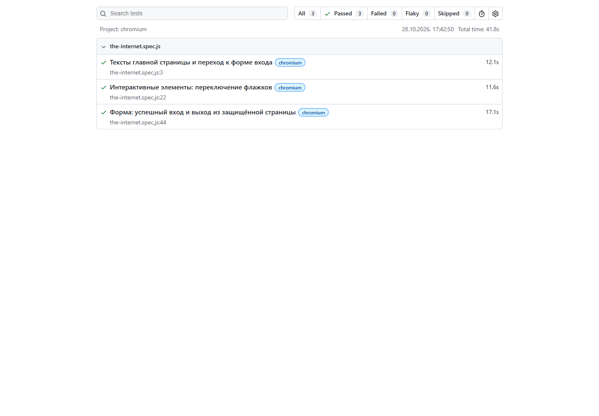

# Практическая работа по Playwright

В работе три теста для сайта [The Internet](https://the-internet.herokuapp.com/). Язык — JavaScript.

Тесты проверяют:

1. Есть ли нужный текст на главной странице и работает ли ссылка на страницу входа.
2. Можно ли поставить и убрать галочки.
3. Работает ли вход по логину и паролю, открывается ли новая страница и получается ли выйти.

В каждом тесте по три шага.

## Как запустить

Нужны Node.js 20 или новее и интернет.

```bash
git clone https://github.com/ZERNOHKA/playwright-practice.git
cd playwright-practice
npm ci
npx playwright install chromium
npm test
```

После тестов можно открыть отчёт:

```bash
npm run report
```

## Результат

Все три теста прошли. На скриншоте результат запуска от 28.10.2026 в Google Chrome: `3 passed (41.8s)`.


